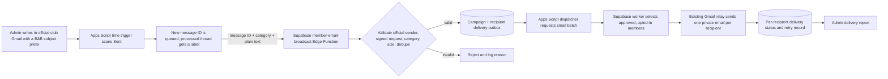

# Brush & Bond member email broadcast architecture

## Goal

An admin writes an update in the official Brush & Bond Gmail account. Only messages with a recognized subject prefix are sent to current members. The message can announce an event, a general notice, an achievement, or another club update.

## Recommended flow

## Trigger and message format

- Do not monitor or forward every message in the Gmail Sent folder. The explicit subject prefixes are the send action: `[B&B EVENT]`, `[B&B ANNOUNCEMENT]`, `[B&B ACHIEVEMENT]`, or `[B&B UPDATE]`.
- An Apps Script time-driven trigger scans Sent for matching messages every five minutes. It adds an internal `B&B Broadcast Processed` label after Supabase accepts the campaign. Send each campaign as a new email thread; don't send a second broadcast as a reply in a processed thread.
- Supabase also records the Gmail message ID, so retries cannot create duplicate campaigns.
- The script sends the message ID, sender, subject, plain-text body, and optional HTML body to a Supabase Edge Function over HTTPS. A shared random secret authenticates the script. The function accepts mail only from `brushandbondgcect22@gmail.com`, validates size and category, sanitizes HTML, and deduplicates by Gmail message ID.

## Recipients and delivery

- Source recipients from `membership_applications` where `status = 'approved'` and `email_updates_opt_in = true`; never include pending, rejected, or non-consenting applications.
- New applicants get an optional email-updates checkbox, unchecked by default. Every email includes an unsubscribe link; unsubscribing turns off their email preference without changing membership status.
- Create one campaign row and one delivery row per recipient in Supabase. Track `pending`, `sending`, `sent`, `failed`, and `skipped` states, provider response, timestamps, and retry count.
- Send each email separately through the existing Gmail relay. Do not place the full member list in `To` or `CC`; this keeps member addresses private.
- Give each delivery an idempotency key based on campaign ID and member ID. Retrying a failed batch must not resend messages already marked sent.
- The dispatcher processes a small batch per run, updates delivery status after each recipient, and resumes pending rows on the next trigger. The admin report shows totals and failed recipients without exposing other members' addresses.

## Components to add or extend

1. **Gmail Apps Script**: `runMemberEmailAutomation` scans tagged subjects and dispatches pending deliveries every five minutes; store the shared secret, Supabase publishable key, endpoint, and sender address in Script Properties.
2. **Supabase migration**: add opt-in preference and campaign/delivery outbox tables, indexes, retention rules, and restrictive RLS. Keep recipient data accessible only to the service role and authorized admins.
3. **Supabase Edge Functions**: add an authenticated ingestion endpoint for signed Apps Script requests and a batch dispatcher. Do not put service-role credentials or the relay secret in the browser app.
4. **Admin UI (follow-up)**: show campaign status and delivery counts; allow safe retry of failed messages. Delivery state is recorded in Supabase until this view is added.
5. **Observability**: record message IDs, campaign IDs, provider outcomes, and errors; never log full recipient lists or secret values.

## Current project state

- `admin-application-status` already sends one membership approval/rejection email using the Gmail relay.
- The relay in `supabase/email-relay/Code.gs` currently accepts one recipient per request and uses an idempotency key.
- Admin announcements and achievements currently save to Supabase; they do not send email to members.
- Approved member addresses come from `membership_applications`. A new optional consent flag defaults to false so existing members are not enrolled without their choice.

## Gmail capacity and graceful behavior

The current official sender is a consumer Gmail account. Google currently documents an Apps Script quota of 100 email recipients per day for consumer accounts and 50 recipients per message; both are subject to change. The relay must check remaining daily quota before each send, pause the queue when it is exhausted, and resume later without duplicating successful deliveries. If the approved, subscribed list grows beyond the free-account quota, same-day delivery to every member cannot be guaranteed with this sender. See [Google Apps Script quotas](https://developers.google.com/apps-script/guides/services/quotas).

Apps Script does not run a simple trigger on every Gmail message. The design uses an installable time-driven trigger to scan for matching subject prefixes; see [Apps Script triggers](https://developers.google.com/apps-script/guides/triggers).

## Rollout sequence

1. Deploy the database migration and Supabase functions.
2. Update the existing Apps Script Web App, add the endpoint and publishable key Script Properties, authorize Gmail access, and install the five-minute trigger.
3. Add the opt-in checkbox to the membership application and ask current members to opt in before adding them to the delivery list.
4. Send one test broadcast to a controlled opted-in member and confirm delivery, unsubscribe, retry, and duplicate suppression.
5. Add an admin delivery report and dry-run recipient preview as a follow-up.
